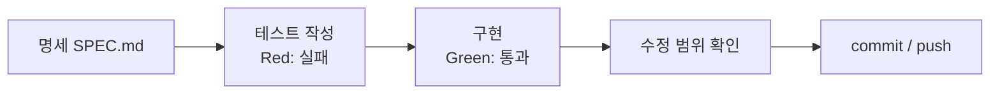
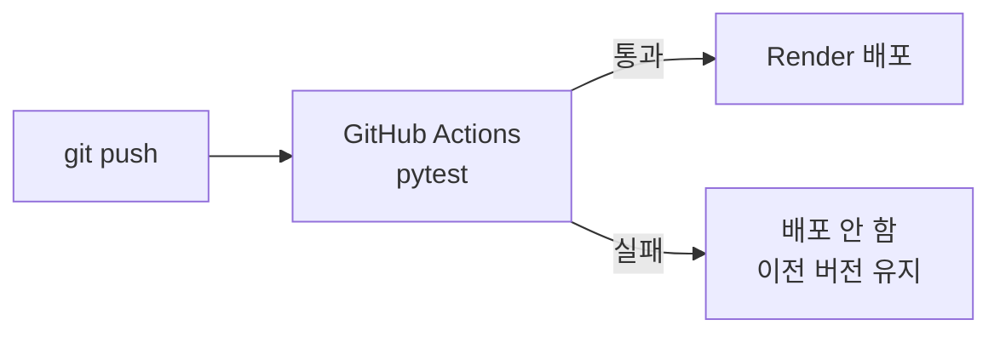

# 리뷰 온도계

> © 2026 김연지. All rights reserved. 수강생 개인 학습용 · 무단 강의·복제·배포·수정 금지 · [LICENSE.md](LICENSE.md)

이 문서는 수업 저장소의 첫 화면입니다. 무엇을 만드는지, 어떤 명령을 복사해 쓰는지, 다른 문서가 어디 있는지 적었습니다.

가상 쇼핑몰 하루마켓의 리뷰 한 건과 별점을 넣으면, 긍정/부정과 리뷰 온도(0~100℃), 별점과 내용이 반대인지 알려 주는 API와 화면입니다. 하루마켓은 수업용 가상 서비스입니다.

- 개발요청서: [REQUEST.md](REQUEST.md)
- 공식 명세서(무엇을 만들지 적은 문서): [SPEC.md](SPEC.md) (1차), [SPEC_COUPON.md](SPEC_COUPON.md) (2차, 쿠폰 API 명세서. 세션 4에서 받습니다)

Python, VS Code 확장, agy는 세션 1에서 설치합니다. 순서는 [docs/01-setup-card.md](docs/01-setup-card.md) B절을 따릅니다. 설치가 끝나면 블록 ①로 확인합니다.

## 오늘 만드는 순서

매 세션 같은 순서로 일합니다.



## 워크북

수업 활동지는 [WORKBOOK.md](WORKBOOK.md)입니다. VS Code에서 열어 직접 채웁니다.

1. 처음 한 번: VS Code 탐색기에서 `WORKBOOK.md`를 복사해 `notes/MY_WORKBOOK.md`로 붙여 넣습니다. 터미널로 한다면 아래 명령을 씁니다.
   - macOS: `mkdir -p notes && cp WORKBOOK.md notes/MY_WORKBOOK.md`
   - Windows PowerShell: `mkdir notes; copy WORKBOOK.md notes\MY_WORKBOOK.md`
2. 내 답은 `notes/MY_WORKBOOK.md`에만 씁니다. 따라잡기 명령(블록 ⑩)은 `WORKBOOK.md`를 원래대로 덮어쓰지만 `notes/` 안의 내 파일은 건드리지 않습니다.
3. 미리보기는 `Ctrl+Shift+V`(Mac `Cmd+Shift+V`)입니다. 체크 칸은 `- [ ]`를 `- [x]`로 바꿉니다. 표의 빈칸은 `|  |` 두 선 사이에 씁니다.
4. 세션이 끝날 때마다 저장하고 commit, push 합니다(블록 ⑨).
5. `notes/MY_WORKBOOK.md`는 내 GitHub 저장소(공개)에 올라갑니다. 개인 정보, API 키, 비밀번호는 쓰지 않습니다.

## 안전 규칙

- AI 채팅에 비밀번호, API 키, 실제 고객 정보, 회사 코드는 넣지 않습니다.
- agy 로그인 때 Google 비밀번호는 로그인 화면에만 입력합니다. AI 채팅에는 넣지 않습니다.
- 결제 수단은 어디에도 등록하지 않습니다.

## 로컬 실행

처음이라면 [docs/01-setup-card.md](docs/01-setup-card.md)를 순서대로 따라 합니다. 요약은 아래와 같습니다.

- 파이썬은 3.11 이상(3.12 권장)이 필요합니다. python.org에서 설치하고(Windows는 Add python.exe to PATH 체크), `python --version`(Mac은 `python3 --version`)으로 확인합니다.
- VS Code를 처음 열면 "이 폴더를 신뢰합니까?" 창이 뜹니다. Yes, I trust를 누르고, 추천 확장 알림은 닫습니다.
- VS Code에 확장 두 개가 필요합니다. 왼쪽 Extensions(네모 4개 아이콘)에서 `Python`(Microsoft)과 `GitHub Copilot Chat`을 검색해 Install 합니다.
- Mac은 편집기 단축키에서만 `Ctrl` 대신 `Cmd`를 씁니다. 터미널의 서버 종료 `Ctrl+C`는 Mac도 `Ctrl`입니다.
- 내 PC에서는 `MODEL_REPO`를 입력하지 않습니다. 모델 저장소 이름(`thisispaperdoll/review-thermo-onnx`)은 코드(`app/sentiment.py`)에 들어 있습니다.

`(.venv)`는 가상환경(이 프로젝트만 쓰는 파이썬 상자)이 켜졌다는 표시입니다.

macOS:

```bash
python3 -m venv .venv
source .venv/bin/activate
pip install -r requirements.txt
uvicorn app.main:app --reload
```

Windows PowerShell:

```powershell
Set-ExecutionPolicy -Scope CurrentUser RemoteSigned
python -m venv .venv
.venv\Scripts\Activate.ps1
pip install -r requirements.txt
uvicorn app.main:app --reload
```

- `Set-ExecutionPolicy`는 한 번만 합니다. 묻는 창에는 `Y`를 씁니다.
- `Activate.ps1`이 안 되면 터미널 오른쪽 위 ▼ → Command Prompt를 열고 `.venv\Scripts\activate.bat`를 칩니다.
- Windows에서 `python`을 치면 Microsoft Store가 열릴 때는 `py`를 씁니다.

브라우저에서 http://localhost:8000 을 엽니다. API 문서는 http://localhost:8000/docs 입니다.

Copilot Chat은 VS Code 맨 위 가운데 검색창 옆의 채팅 아이콘으로 엽니다. 단축키는 Windows `Ctrl+Alt+I`, Mac `Ctrl+Cmd+I`입니다. 모드 드롭다운은 입력창 아래에 있습니다. Ask와 Agent가 보이면 성공입니다(Plan은 버전에 따라 보입니다).

agy는 프로젝트 폴더의 터미널에서 `agy`를 입력해 켭니다. 처음 켤 때 본인 Google 계정으로 로그인합니다.

git 이메일: Public 저장소에서는 commit에 이메일이 보입니다. 원하지 않으면 GitHub Settings → Emails의 noreply 주소를 씁니다.

## 테스트

`review-thermo` 폴더에서 실행합니다.

```bash
pytest -v
```

테스트는 가짜 AI 부품을 쓰므로 모델도 인터넷도 필요 없습니다. pytest가 처음이라면 [docs/02-pytest.md](docs/02-pytest.md)를 먼저 읽습니다.

## 명령 복사 블록

GitHub 화면에서 코드 블록 오른쪽 위의 복사 버튼으로 복사해 터미널에 붙여 넣습니다. 번호는 수업 슬라이드의 "README ⑥ 복사" 표시와 같습니다. ⑭⑯⑰은 세션 4에서 새로 쓰는 블록입니다.
꺾쇠 `< >`는 빼고 내 값으로 바꿉니다. 예: `<내아이디>`는 `haru123`.

① 설치 확인 (Mac은 `python --version` 대신 `python3 --version`)

```text
python --version
git --version
code --version
agy --version
```

①-2 agy 설치 · Windows PowerShell (끝나면 새 터미널에서 `agy --version`)

```powershell
irm https://antigravity.google/cli/install.ps1 | iex
```

①-2 agy 설치 · macOS

```bash
curl -fsSL https://antigravity.google/cli/install.sh | bash
```

② 저장소 받기 (`<내아이디>` 자리에 내 GitHub 아이디를 씁니다)

```text
git clone https://github.com/<내아이디>/review-thermo.git
cd review-thermo
code -r .
```

③ Git 이름 설정 (처음 한 번만)

```text
git config --global user.name "내 이름"
git config --global user.email "GitHub 가입 이메일"
```

④ 가상환경 · macOS

```bash
python3 -m venv .venv
source .venv/bin/activate
pip install -r requirements.txt
```

⑤ 가상환경 · Windows PowerShell

```powershell
python -m venv .venv
.venv\Scripts\Activate.ps1
pip install -r requirements.txt
```

⑥ 서버 켜기 (브라우저에서 http://localhost:8000)

```text
uvicorn app.main:app --reload
```

⑦ 테스트

```text
pytest -v
```

⑧ 수정 범위 확인 (`git restore`는 `tests/`나 `SPEC.md`가 바뀌었을 때만)

```text
git diff --stat
git status
git restore tests/ SPEC.md
```

⑨ 저장하고 올리기 (`"메시지"` 자리에 내 설명을 적습니다)

```text
git add .
git commit -m "메시지"
git push
```

⑩ 따라잡기 (`<브랜치>` 자리에 수업에서 알려 주는 이름을 씁니다. 예: `cp3-tdd`)

```text
git fetch origin
git checkout origin/<브랜치> -- .
```

⑪ 공식 명세 받기

```text
git fetch origin
git checkout origin/cp2-spec -- SPEC.md
```

⑫ CI 파일 복사 (macOS)

```bash
mkdir -p .github/workflows && cp deploy/ci.yml .github/workflows/ci.yml
```

⑫ CI 파일 복사 (Windows PowerShell)

```powershell
New-Item -ItemType Directory -Force .github\workflows; Copy-Item deploy\ci.yml .github\workflows\ci.yml
```

⑬ 되돌리고 다시 올리기

```text
git revert HEAD --no-edit
git push
```

⑭ 쿠폰 API 명세와 계약 테스트 받기 (세션 4)

```text
git fetch origin
git checkout origin/cp5-coupon-spec -- SPEC_COUPON.md tests/test_api_coupon.py
```

⑮ Render 설정값

```text
Build Command: pip install -r requirements.txt
Start Command: uvicorn app.main:app --host 0.0.0.0 --port $PORT
```

⑯ 수정 범위 확인 (세션 4: 쿠폰. `git restore`는 `tests/`나 `SPEC_COUPON.md`가 바뀌었을 때만)

```text
git diff --stat
git status
git restore tests/ SPEC_COUPON.md
```

⑰ 새 프로젝트 폴더 만들기 (세션 4-2. review-thermo의 서버·agy·가상환경을 끈 뒤)

macOS:

```bash
cd ..
mkdir review-cleanbot && cd review-cleanbot
cp ../review-thermo/docs/04-cleanbot-request.md REQUEST.md
python3 -m venv .venv
source .venv/bin/activate
pip install pytest
mkdir tests
git init
code -r .
```

Windows PowerShell:

```powershell
cd ..
mkdir review-cleanbot; cd review-cleanbot
copy ..\review-thermo\docs\04-cleanbot-request.md REQUEST.md
python -m venv .venv
.venv\Scripts\Activate.ps1
pip install pytest
mkdir tests
git init
code -r .
```

## 수업 자료

파일 이름 앞 숫자는 쓰는 세션입니다. `00`은 하루 내내 옆에 두고 보는 자료입니다.

| 세션 | 실습 자료 |
|---|---|
| 00 (항상) | [개념 노트](docs/00-concepts.md) · [용어 사전](docs/00-glossary.md) · [화면 메시지 사전](docs/00-troubleshooting.md) |
| 1 | [환경설정 카드](docs/01-setup-card.md) · [Copilot과 agy 사용 안내](docs/01-copilot-guide.md) · [프롬프트 시트](docs/01-prompt-sheet.md) |
| 2 | [pytest 소개](docs/02-pytest.md) |
| 3 | [Vercel 배포(대안)](docs/03-vercel.md) |
| 4 | [3차 요청서 · 리뷰 클린봇](docs/04-cleanbot-request.md) |

## 배포

push 하면 GitHub Actions가 테스트를 돌립니다. 통과하면 Render가 배포하고, 실패하면 배포하지 않습니다.



- 배포 URL: (여기에 Render URL 입력)
- CI 상태: (여기에 GitHub Actions 배지 입력)
