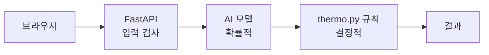
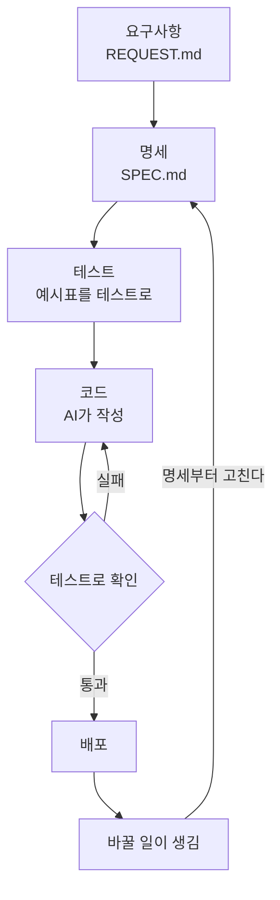
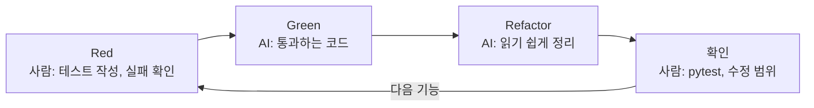
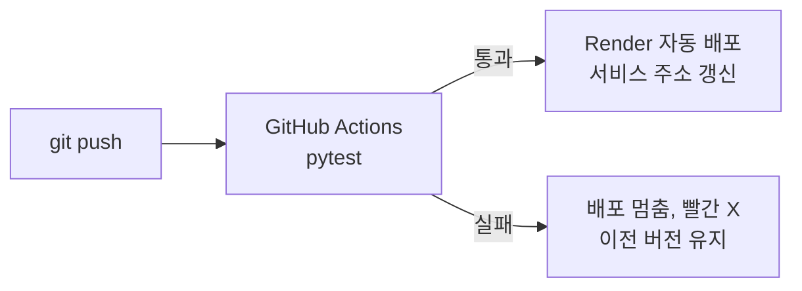

# 개념 노트

> © 2026 김연지. All rights reserved. 수강생 개인 학습용 · 무단 강의·복제·배포·수정 금지 · [LICENSE.md](../LICENSE.md)

이 문서는 수업에서 나온 말을 모아 정리한 노트입니다. 수업이 끝난 뒤 헷갈릴 때 찾아봅니다. 외울 필요는 없습니다.

> 안전 규칙
> - AI 채팅에 비밀번호, API 키, 실제 고객 정보, 회사 코드는 넣지 않습니다.
> - 결제 수단은 어디에도 등록하지 않습니다.

## 1. 코드 작성은 개발의 일부입니다

개발자의 일은 다섯 칸입니다.

1. 무엇을 만들지 정하기 (요구사항)
2. 설계
3. 코드 작성 (AI가 가장 빨라진 곳)
4. 테스트·확인
5. 배포·운영·고치기

"개발의 80%는 코드 작성이 아니다"는 통계가 아니라 업계에서 흔히 하는 말입니다. AI가 코드를 빨리 써 줄수록 앞(무엇을 만들지 정하기)과 뒤(맞는지 확인하기)가 사람에게 남습니다. 오늘 수업은 앞의 명세와 뒤의 테스트를 다뤘습니다.

## 2. 바이브 코딩

2025년 초 AI 연구자 안드레이 카파시가 말해서 유명해졌습니다. 코드를 보지 않고 분위기(vibe)에 맡기고, 에러가 나면 AI에게 던지는 방식입니다.

| 방식 | 뜻 | 어울리는 곳 |
|---|---|---|
| 순수한 바이브 코딩 | 돌아가면 끝 | 하루짜리 장난감 |
| 책임감 있는 AI 지원 개발 | 테스트와 변경 내용을 사람이 확인 | 업무용 서비스 |

2026년에 확인된 자료입니다.

| 내용 | 출처 |
|---|---|
| 개발에 AI 도구를 쓰는 개발자는 83%입니다 (2023년 44%, 2024년 62%) | Stack Overflow 2026 개발자 설문, 2026년 10월 |
| 같은 설문에서 결과를 쉽게 검증할 수 있으면 AI를 믿는다는 응답은 48%, 중요한 결정에 믿는다는 응답은 7%였습니다 | 위와 같음 |
| AI가 만든 코드의 보안 테스트 통과율은 56%로 1년째 제자리입니다. 문법은 거의 100% 맞습니다 | Veracode 2026 GenAI Code Security Report, 2026년 7월 |
| 숙련 개발자가 AI를 쓰고 실제로는 19% 느려졌는데, 본인은 20% 빨라졌다고 느꼈습니다 | METR, 2025년 7월 |
| 2026년 4월, AI 코딩 에이전트가 운영 데이터베이스와 백업을 9초 만에 지워 서비스가 30시간 멈췄습니다 | OECD AI 사고 데이터베이스 |

METR의 2026년 후속 실험도 비슷했습니다. 다만 참가자 상당수가 AI 없이 일하기를 거부해서, METR 스스로 "신뢰하기 어려운 신호"라고 보고 실험을 다시 설계하고 있습니다.

겁을 주려는 숫자가 아닙니다. 느낌과 실제가 다를 수 있으니 느낌이 아니라 테스트로 확인하자는 뜻입니다.

## 3. AI 코딩 도구의 세 가지 유형

도구는 얼마나 알아서 움직이는지(자율성)로 나눕니다.

| 유형 | 비유 | 예 | 오늘 |
|---|---|---|---|
| 1. 앱 빌더 | 한 줄 주문으로 완성품 | 프롬프트 한 줄로 앱을 만드는 서비스 | 쓰지 않음 |
| 2. IDE 어시스턴트 | 편집기 옆의 페어 프로그래머 | VS Code의 GitHub Copilot | 직접 씀 |
| 3. 터미널 에이전트 | 일을 맡기는 주니어 개발자 | Antigravity CLI(agy), Claude Code, Codex CLI | agy를 직접 씀 |

앱 빌더는 빠르지만 고치고 넓히기 어렵습니다. 알아서 움직이는 도구일수록 맡길 범위와 확인 기준을 먼저 정합니다.

## 4. AI는 다음 말을 확률로 고릅니다

AI는 정답을 아는 것이 아니라 다음에 올 말을 확률로 고릅니다. 그래서 그럴듯한 코드와 맞는 코드는 다릅니다.

| 한계 | 뜻 | 예 |
|---|---|---|
| 환각 | 없는 것을 지어냄 | 없는 함수 이름을 자신 있게 씀 |
| 지식 단절 | 배운 시점 이후를 모름 | 예전 문법으로 코드를 씀 |
| 컨텍스트 이탈 | 보여 준 것만 앎 | 파일을 안 보여 주면 엉뚱하게 추측 |

사람은 상식으로 빈칸을 메우고, AI는 학습한 확률로 메웁니다. 그래서 그럴듯하지만 우리 것이 아닌 답이 나옵니다.

같은 부탁, 다른 결과: "리뷰가 얼마나 좋은지 온도로 보여 주는 함수 만들어 줘."를 세 명이 각자 AI에 넣으면 계산식, 소수점 자리, 정확히 0.5일 때의 처리, 함수 이름이 다르게 나옵니다. AI 실력 때문이 아니라 부탁이 모호해서 AI가 빈칸을 각자 다르게 추측한 것입니다. 문제는 코드가 아니라 의도입니다.

## 5. 프롬프트 → 컨텍스트 → 하네스

| 시기 | 이름 | 질문 | 오늘 한 일 |
|---|---|---|---|
| 2022~24 | 프롬프트 엔지니어링 | 무엇을 말할 것인가 | 4요소, 개발 부탁 4칸 |
| 2025 | 컨텍스트 엔지니어링 | 무엇을 넣을 것인가 | AGENTS.md, 명세서 |
| 2026 | 하네스 엔지니어링 | 어떤 장치로 감쌀 것인가 (검증, 재시도, 승인) | 테스트, CI |

앞 기법이 없어진 것이 아니라 층이 쌓인 것입니다. 오늘 세 층을 모두 해 봤습니다.

- 부탁과 강제: AGENTS.md는 AI에게 하는 부탁입니다. AI는 부탁을 가끔 잊거나 어깁니다. 테스트와 CI는 강제입니다. 테스트가 실패하면 배포가 멈추므로 어길 수 없습니다. 중요한 약속은 테스트로 만듭니다.
- 컨텍스트 예산: 관련 없는 문서를 함께 넣으면 오히려 정확도가 떨어집니다. 무엇을 넣을지 고르는 일이 설계입니다.
- 넣으면 안 되는 것: 개인정보, 계좌·카드번호, 자격증명(API 키, 토큰, 비밀번호), 대외비
- 잘 되는 프롬프트는 파일로 저장하고 Git으로 버전을 관리합니다.

## 6. 컨텍스트 오염과 새 채팅

컨텍스트 창은 AI가 한 번에 보는 작업 책상입니다. 책상 크기에는 한계가 있습니다. 대화가 길어지면 책상 위가 어지러워집니다.

| 어지러운 것 | 뜻 |
|---|---|
| 오래된 결정 | 바꾼 규칙과 옛 규칙이 섞입니다 |
| 실패한 시도의 잔해 | 틀린 코드를 계속 참고합니다 |
| 관계없는 대화 | 지금 일과 상관없는 내용이 쌓입니다 |

처방은 세 가지입니다.

1. 새 채팅을 엽니다. 채팅 패널의 + 버튼을 누릅니다.
2. 필요한 파일만 붙입니다. `AGENTS.md`, `SPEC.md`
3. 결정은 대화가 아니라 파일에 적습니다. 대화는 언제든 새로 시작할 수 있어야 합니다.

## 7. 코딩 에이전트 = LLM + 도구 + 반복

- LLM: 글을 만드는 AI 두뇌
- 도구: 파일 읽기·쓰기, 명령 실행
- 반복: 해 보고 → 결과를 보고 → 다시 고침

Copilot Agent 모드와 agy가 이 구조입니다. 도구가 있어서 내 파일을 실제로 고칩니다. 그래서 확인이 더 필요합니다.

2026년 3월과 4월에는 AI 코딩 에이전트가 운영 인프라와 백업을 지워 큰 장애가 난 사고도 있었습니다. 공통점은 권한과 확인 절차가 없었다는 것입니다. 출처는 2절의 OECD AI 사고 데이터베이스 사례이고, 3월 사례는 슬라이드 각주에 있습니다.

## 8. AGENTS.md와 스킬

| | AGENTS.md | 스킬(SKILL.md) |
|---|---|---|
| 정체 | 항상 적용되는 프로젝트 규칙 | 특정 작업의 레시피 |
| 위치 | 저장소 맨 위 `AGENTS.md` | `.agents/skills/<이름>/SKILL.md` (Copilot은 `.github/skills/`도 읽습니다) |
| 언제 읽나 | 일을 시작할 때마다 | 이름과 설명만 먼저 읽고, 관련 있을 때 본문을 불러옴 |
| 예 | "`tests/`와 `SPEC.md`는 고치지 않는다" | "명세 예시표를 pytest 행으로 옮기기" |

같은 부탁을 세 번 이상 길게 설명하고 있다면 스킬로 만들 때입니다(VS Code 문서 "Use Agent Skills in VS Code"). 오늘은 스킬을 직접 만들지 않고 받은 스킬을 읽고 고쳐 썼습니다.

## 9. 확률적인 AI, 결정적인 규칙

- AI 부품(`app/sentiment.py`, 긍정 확률을 주는 모델)은 확률적입니다. 같은 글이라도 모델이나 버전이 바뀌면 점수가 달라지고, 가끔 틀립니다. 사람이 관찰하고 검수합니다.
- 온도·불일치·쿠폰 규칙(`app/thermo.py`와 세션 4에서 만드는 쿠폰 규칙 함수)은 결정적입니다. 같은 입력이면 같은 출력입니다. 그래서 예시표와 테스트로 고정합니다.
- 테스트에서는 AI 모델 대신 가짜 점수를 끼워 넣습니다. 그러면 결과가 늘 같습니다.

확률적인 부분은 감싸고, 결정적인 부분은 테스트로 고정합니다.

리뷰 한 건이 지나가는 길입니다. AI 모델만 확률적이고, 나머지는 결정적입니다.



## 10. 명세(Spec)

명세는 "무엇을 만들지"를 사람이 읽고 기계도 따를 수 있게 적은 문서입니다. 명세는 프롬프트가 아니라 계약입니다. 계약에는 완료를 증명하는 방법이 들어갑니다. 좋은 명세는 세 기둥으로 봅니다.

| 기둥 | 질문 | 오늘의 예 |
|---|---|---|
| 맥락(Context) | 왜, 누구를 위해, 무엇을 받고 돌려주나 | 입력: 리뷰 글, 별점 / 출력: 긍정·부정, 온도, 불일치 |
| 통제(Control) | 무엇을 만들고, 무엇은 하지 않나 | 규칙: 0.5 이상이면 긍정 / 거절: 빈 글, 별점 6 / 하지 말 것: 리뷰 저장 안 함 |
| 정확성(Correctness) | 완료를 어떻게 증명하나 | 예시표: 0.8732 → 87.3℃ |

세 번째 기둥인 예시표가 나중에 그대로 테스트 행이 됩니다. 명세에는 다섯 가지가 들어갑니다.

- 입력: 무엇을 받나 (글 1~500자, 별점 1~5)
- 출력: 무엇을 돌려주나 (label, score, temperature, mismatch)
- 규칙: 어떻게 계산하나 (0.5 이상이면 positive)
- 예시: 입력과 결과의 짝 (예시표)
- 거절 조건: 어떤 입력을 받지 않나 (빈 글 → 422)

## 11. SDD (명세 주도 개발)

코드보다 명세가 먼저입니다. "코드가 진실의 원천"에서 "의도가 진실의 원천"으로 바뀝니다.

### SDD 쉽게 이해하기

SDD는 만들기 전에 "무엇을 만들지"를 글로 먼저 적는 방법입니다.

비유로 보면 쉽습니다.

| 비유 | 설계도가 없을 때 | 설계도가 있을 때 |
|---|---|---|
| 집 짓기 | "방 세 개짜리 집 지어 주세요"만 말하면 건축가마다 다른 집이 나옵니다 | 방 크기와 문 위치가 그려져 있어서 누가 지어도 같은 집이 나옵니다 |
| 식당 주문 | "맛있는 거 주세요" | "된장찌개, 밥 곱빼기, 맵지 않게" |

두 문장으로 줄이면 이렇습니다.

- 명세는 사람과 AI의 약속입니다.
- 테스트는 그 약속을 지켰는지 재는 자입니다.

명세에는 다섯 가지를 적습니다.

| 적을 것 | 질문 | 오늘의 예 |
|---|---|---|
| 받는 것 | 무엇을 받나 | 리뷰 글 1~500자, 별점 1~5 |
| 돌려주는 것 | 무엇을 돌려주나 | label, score, temperature, mismatch |
| 규칙 | 어떻게 정하나 | 0.5 이상이면 positive |
| 예시 | 입력이 이러면 결과는? | 0.8732 → 87.3 |
| 오류 | 어떤 입력을 거절하나 | 빈 글이면 422 |

명세가 없을 때와 있을 때를 비교해 봅니다. 같은 부탁입니다.

> "리뷰가 얼마나 좋은지 온도로 보여 주는 함수 만들어 줘."

명세가 없으면 AI는 빈칸을 각자 추측합니다. 아래는 AI 두 개가 이렇게 갈릴 수 있다는 예입니다.

| 정해지지 않은 것 | 첫 번째 AI가 추측한 것 (예) | 두 번째 AI가 추측한 것 (예) |
|---|---|---|
| 계산식 | 점수 × 100 | 점수를 5단계로 나눔 |
| 소수점 | 소수점 아래 버림 | 첫째 자리 반올림 |
| 정확히 0.5일 때 | 부정 | 긍정 |
| 함수 이름 | `calc_temp` | `review_temperature` |

명세가 있으면 빈칸이 없습니다. "score × 100을 소수점 첫째 자리까지 반올림, 0.5 이상이면 positive, 함수 이름은 `to_temperature`"라고 적혀 있으니 어느 AI에게 시켜도 같은 결과가 나옵니다. 달라지면 테스트가 잡아 줍니다.

오늘 하루에 SDD가 나오는 곳은 두 군데입니다.

| 세션 | 명세 | 어떻게 쓰나 |
|---|---|---|
| 세션 2 | `SPEC.md` (규칙 명세) | 규칙과 예시표를 쓰고, 함수 뼈대에 규칙을 채웁니다 |
| 세션 4-1 | `SPEC_COUPON.md` (API 명세) | 코드 뼈대 없이 이 문서만 보고 모델, 주소, 규칙을 처음부터 만듭니다 |
| 세션 4-2 | 명세 없음. `REQUEST.md`(3차 요청)만 | agy의 질문에 답하며 `AGENTS.md`와 `SPEC.md`(요구사항 · 설계 · 작업)를 내가 만들고, 작업마다 테스트를 먼저 씁니다 |

SDD의 순서는 이렇습니다. 바꿀 일이 생기면 코드가 아니라 명세부터 고칩니다.



### SDD 도구

| 도구 | 순서 | 비고 |
|---|---|---|
| GitHub Spec Kit | Specify(무엇을) → Plan(어떻게) → Tasks(할 일 쪼개기) → Implement(구현) | 2025년 9월 공개, 2026년 8월 v1.0 정식, 코딩 에이전트 38종과 연동 |
| AWS Kiro | Requirements(요구사항, EARS 수용 기준) → Design(설계) → Tasks(할 일) | 2025년 7월 공개, 2025년 11월 정식 출시. 명세에서 속성을 뽑아 무작위 테스트를 대량으로 만드는 속성 기반 테스트도 함 |

출처는 문서 아래 '더 읽어 보기'에 있습니다. 도구는 달라도 순서는 같습니다. 무엇을 만들지 → 어떻게 만들지 → 작게 나누기 → 구현

SDD가 만능은 아닙니다.

| 한계 | 대처 |
|---|---|
| 명세 쓰는 데 코딩보다 오래 걸릴 수 있다 | 명세 크기를 기능 크기에 맞춥니다. 작은 기능은 예시표 몇 줄이면 됩니다 |
| AI가 명세 일부를 무시한다 | 테스트로 판정합니다 |
| 대화가 길어지면 명세를 잊는다 | 새 채팅에 `SPEC.md`를 다시 붙입니다 |

명세는 출발점이고, 테스트는 안전망입니다.

### EARS: 수용 기준을 "~하면 ~한다"로 쓰기

수용 기준은 "이 조건을 통과하면 합격"이라는 기준입니다. EARS(Easy Approach to Requirements Syntax) 형식으로 쓰면 애매함이 줄어듭니다. Kiro가 요구사항을 이 형식으로 씁니다.

```text
WHEN 조건 THE SYSTEM SHALL 동작
(조건이면, 시스템은 동작한다)
```

- 나쁜 예: "부정적인 리뷰는 잘 걸러야 한다." 무엇이 '잘'인지 정해져 있지 않아서 테스트로 옮길 수 없습니다.
- 좋은 예: 긍정 확률이 0.5 이상이면, 시스템은 positive를 돌려준다.
- 좋은 예: 리뷰가 비어 있으면, 시스템은 422를 돌려준다.
- 좋은 예: 별점이 3이면, 시스템은 불일치가 아니라고 판정한다.

"~하면 ~한다"로 쓴 문장은 입력과 기대 결과가 분명해서 그대로 테스트 한 줄이 됩니다.

## 12. 테스트

테스트는 입력을 넣고 기대값과 같은지 자동으로 확인하는 프로그램입니다. 중심은 `assert`(단언, "이래야 한다")입니다.

```text
assert to_label(0.5) == "positive"
```

한 번 만들어 두면 코드를 고칠 때마다 다시 돌려서, 전에 되던 것이 깨졌는지(회귀)를 알려 줍니다.

pytest에서는 이름이 `test_to_label[0.5_boundary]`처럼 나옵니다. 대괄호 안은 예시표의 한 줄입니다. 테스트 행은 예시표처럼 생긴 데이터 한 줄입니다.

```text
pytest.param(0.5, "positive", id="0.5_boundary")
```

pytest 사용법은 [pytest 소개](02-pytest.md)에 있습니다.

## 13. TDD (테스트 주도 개발)

켄트 벡이 『Test-Driven Development: By Example』(2002)에서 소개했습니다. 보통은 코드를 먼저 쓰고 테스트는 나중에(자주 생략) 합니다. TDD는 테스트를 먼저 씁니다. 그러면 '다 됐다'의 뜻이 미리 정해집니다.

먼저 쓰는 이유는 세 가지입니다.

1. 완료 기준을 먼저 정합니다.
2. 실패를 먼저 보면 그 테스트가 진짜 검사하는지 압니다. 처음부터 통과하는 테스트는 아무것도 검사하지 않을 수 있습니다.
3. 나중에 코드를 고칠 때 깨진 곳을 바로 압니다.

순서는 Red → Green → Refactor(정리)입니다. 오늘은 세션 2에서 세 박자를 모두 해 봅니다. 사람은 매번 마지막에 직접 확인합니다.



| 박자 | 누가 | 하는 일 |
|---|---|---|
| Red | 사람 | 예시표로 테스트를 만들고 실패를 눈으로 확인합니다 |
| Green | AI | 테스트를 통과할 만큼만 가장 단순한 코드를 씁니다 |
| Refactor | AI | 동작은 그대로 두고 코드를 읽기 쉽게 정리합니다. 숫자에 이름 붙이기, 겹치는 부분 줄이기 같은 일입니다. 테스트는 건드리지 않고, 끝나면 다시 `pytest`를 돌립니다 |
| 확인 | 사람 | 전체를 다시 실행해 `pytest` 결과를 읽고, 다른 곳이 깨졌는지 봅니다 |

AI가 Green을 맡을수록 사람은 Red와 확인에 집중합니다. 그래서 가장 중요한 테스트 2개는 사람이 직접 씁니다. 정리(Refactor)를 마음 놓고 할 수 있는 것도 테스트가 지켜 주기 때문입니다.

### AI 시대에 TDD가 더 필요한 이유

- AI는 빠르지만 가끔 틀립니다. 빠른 만큼 확인 장치가 필요합니다.
- 테스트는 AI의 답을 쉽게 검증할 수 있게 하고, AI에게 멈출 곳(완료 기준)을 줍니다. 앞의 Stack Overflow 설문에서 검증이 쉬우면 믿는다는 응답이 48%였습니다.
- AI가 테스트를 몰래 고쳐서 통과시키기도 합니다. 그래서 수정 범위 확인을 합니다. `git diff --stat`(바뀐 파일)과 `git status`(새 파일)로 AI가 고치라고 한 파일만 고쳤는지 봅니다. 정상이면 `app/thermo.py`만 나옵니다. `tests/`나 `SPEC.md`가 바뀌었다면 `git restore tests/ SPEC.md`로 되돌립니다. 그리고 하지 말 것 칸을 더 분명히 써서 다시 부탁합니다.

### 구현 전에 계획 먼저

구현을 맡기기 전에 Copilot의 Plan 모드를 쓰거나 "코드를 쓰기 전에 무엇을 바꿀지 계획만 보여 줘"라고 부탁합니다. 계획을 먼저 보면 엉뚱한 파일을 고치기 전에 멈출 수 있습니다.

### SDD와 TDD의 연결

예시표, 수용 기준, 테스트는 한 줄로 이어집니다.

| 단계 | 예 |
|---|---|
| 1. `SPEC.md` 예시표의 한 행 | 0.5 → positive |
| 2. 수용 기준 문장 | 긍정 확률이 0.5 이상이면 positive를 돌려준다 |
| 3. `tests/` 테스트의 한 행 | `pytest.param(0.5, "positive", id="0.5_boundary")` |
| 4. pytest 실행 결과 | `[0.5_boundary] PASSED` |

명세가 정답을 정하고 테스트가 그 정답을 지킵니다.

## 14. 단위 테스트와 API 테스트

| | 단위 테스트 | API 테스트 (계약 테스트) |
|---|---|---|
| 파일 | `tests/test_thermo.py` | `tests/test_api.py`, `tests/test_api_coupon.py` |
| 확인 대상 | 함수 하나 (to_label 등) | 요청을 보내고 받는 창구 전체 |
| 비유 | 부품 하나 검사 | 완성품 스위치를 눌러 보기 |

계약 테스트는 HTTP 요청을 보내고 응답(번호와 내용)만 확인합니다. 코드를 어떻게 나눴는지는 보지 않습니다. 그래서 API 명세만 있고 코드 뼈대가 없는 세션 4에서도 판정할 수 있습니다.

API 테스트에서는 AI 모델 대신 가짜 점수를 끼워 넣습니다(`get_predict` 의존성 교체). AI 모델은 가짜로 바꿔 끼우고, 규칙은 진짜로 테스트합니다.

## 15. CI/CD

- CI(지속적 통합): 올릴 때마다 로봇이 테스트를 돌립니다 (GitHub Actions).
- CD(지속적 배포): 테스트를 통과하면 자동으로 서비스에 반영합니다 (Render, Auto-Deploy "After CI Checks Pass").



실패하면 이전 버전이 그대로 서비스되므로 사용자는 고장 난 화면을 보지 않습니다. "테스트를 통과한 코드만 배포"가 요청서 4장의 약속이었습니다.

비밀값은 코드에 쓰지 않습니다. API 키, 비밀번호를 코드에 적어 push 하면 저장소에 그대로 남습니다. 비밀값은 Render 환경 변수나 GitHub Secrets에 넣습니다. 오늘의 `MODEL_REPO`가 환경 변수의 예입니다.

## 16. HTTP 상태 코드

번호의 첫 자리만 봐도 누구 쪽 문제인지 대략 압니다.

| 코드 | 뜻 | 오늘의 예 | 할 일 |
|---|---|---|---|
| 200 | 성공 | 분석 결과가 나옴 | 그대로 사용 |
| 422 | 입력이 규칙에 안 맞음 | 빈 글, 500자 초과, 별점 6 | 보낸 쪽을 확인 |
| 405 | 이 주소는 이 방식(POST)을 받지 않음 | 쿠폰 API를 만들기 전의 `/v1/coupons/issue` | 만들 차례 (주소가 아직 없음) |
| 501 | 아직 만들지 않은 기능 | 함수가 NotImplementedError | 만들 차례 |
| 503 | 부품이 응답하지 못함 | 모델을 불러오지 못함 | 서버 사정 (`MODEL_REPO` 확인) |

AI에게 디버깅을 부탁할 때는 에러 번호를 가장 먼저 알려 줍니다.

## 17. 출시한 뒤에도 고리는 돕니다

AI 모델은 배운 데이터만큼만 압니다. 오늘의 모델은 쇼핑 리뷰가 아니라 영화 리뷰로 배웠습니다. 그래서 출시 뒤에 관찰이 필요합니다. LLMOps의 기본 고리입니다.

| 단계 | 오늘의 예 |
|---|---|
| Launch (출시) | 서비스를 공개합니다 |
| Observe (관찰) | 샘플 리뷰 30건을 눌러 이상한 판정을 찾습니다 |
| Evaluate (평가) | 몇 건 맞았는지 셉니다 |
| Improve (개선) | 어떻게 고칠지 아이디어를 냅니다. 고친 서비스를 다시 출시합니다 |

예: "참 빨리도 오네요. 2주 만에."처럼 비꼬는 말은 사람도 헷갈립니다. "배송이 늦어요" 같은 쇼핑 말투도 낯설 수 있습니다.

## 18. 이해 부채

AI가 쓴 코드를 이해하지 못한 채 쌓아 두면 나중에 고치지도 설명하지도 못합니다. 이것을 이해 부채(빚)라고 합니다.

> "다른 사람에게 정확히 설명할 수 없는 코드는 커밋하지 않는다." (Simon Willison, 2025년 3월)

AI가 쓴 코드도 내가 설명할 수 있을 때 내 코드가 됩니다. 방법은 간단합니다. AI에게 "이 함수를 처음 배우는 사람에게 3줄로 설명해 줘"라고 묻고, 그 설명을 읽지 말고 내 말로 바꿔 짝에게 설명합니다.

## 19. 계획자, 생성자, 평가자

오늘 수업은 세 역할로 나뉩니다.

| 역할 | 누가 | 하는 일 |
|---|---|---|
| 계획자(Planner) | 사람 | 요청서를 명세서와 예시표로 바꿉니다 |
| 생성자(Generator) | AI | 테스트 행과 코드를 씁니다 |
| 평가자(Evaluator) | 테스트와 CI | 통과·실패를 판정합니다. 사람이 결과를 확인하는 일도 평가의 일부입니다 |

실패하면 생성자에게 되돌아가 다시 합니다. 하네스 엔지니어링의 기본 구조이고, 카파시가 2026년 2월에 말한 에이전틱 엔지니어링("에이전트를 지휘·감독하되 품질은 타협하지 않는다", 출처: 슬라이드 각주)의 모습입니다. AI가 코드를 쓰는 시대에 사람은 계획하고 판정 기준을 세우는 자리에 섭니다.

## 더 읽어 보기

- GitHub 블로그, Spec Kit: https://github.blog/ai-and-ml/github-copilot/spec-driven-development-with-ai-get-started-with-a-new-open-source-toolkit/
- Kiro 소개: https://kiro.dev/blog/introducing-kiro/
- VS Code 문서, Use Agent Skills in VS Code
- Google Cloud, 바이브 코딩이란: https://cloud.google.com/discover/what-is-vibe-coding?hl=ko
