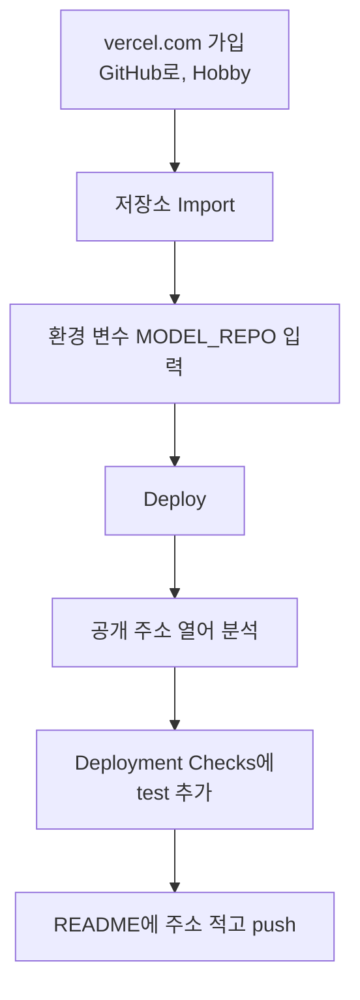

# 세션 3 대안 — Vercel로 배포하기

> © 2026 김연지. All rights reserved. 수강생 개인 학습용 · 무단 강의·복제·배포·수정 금지 · [LICENSE.md](../LICENSE.md)

이 문서는 Render가 막혔을 때 Vercel로 배포하는 방법입니다. 저장소 코드는 그대로이고 배포하는 곳만 바뀝니다. GitHub Actions(테스트 자동 실행)는 Render 때와 똑같이 씁니다.

> 안전 규칙
> - AI 채팅에 비밀번호, API 키, 실제 고객 정보, 회사 코드는 넣지 않습니다.
> - 결제 수단은 어디에도 등록하지 않습니다.
> - Vercel은 무료 Hobby 플랜이면 됩니다. 카드 입력 화면이 나오면 멈추고 손을 듭니다.

## 언제 Vercel로 바꾸나

- Render 가입 화면에서 결제 수단을 요구할 때
- Render 가입이 진행되지 않을 때
- Render 빌드가 두 번 연속 실패하고 원인을 찾기 어려울 때
- 강사가 "이번에는 Vercel로 갑니다"라고 안내했을 때

## Render와 다른 점

| | Render | Vercel |
|---|---|---|
| 서버 방식 | 서버 한 대가 계속 켜져 있음 (15분 쉬면 잠듦) | 요청이 올 때 함수로 실행 (서버리스) |
| 첫 요청 | 잠에서 깨느라 느림 | 새로 시작할 때 모델을 내려받느라 느림 |
| 설정 | Build, Start 명령을 직접 입력 | FastAPI를 자동으로 알아봄. 입력할 명령 없음 |
| 테스트를 통과해야 공개 | Auto-Deploy "After CI Checks Pass" | Deployment Checks에 GitHub Actions의 `test` 추가 |
| Python 버전 | `.python-version` (3.12) | `.python-version` (3.12). Vercel은 3.12 이상만 지원 |

## 순서

세션 3의 CI 단계(Actions 초록 체크)까지는 그대로 합니다. 그다음부터 아래 순서입니다.

1. vercel.com → Sign Up → Continue with GitHub → Hobby를 고릅니다.
2. Add New… → Project → 내 `review-thermo` 저장소 옆 Import를 누릅니다.
3. Framework Preset에 FastAPI가 자동으로 잡혔는지 봅니다. Build와 Output 설정은 비워 둡니다.
4. Environment Variables에 `MODEL_REPO`를 넣습니다. 값은 강사가 알려 준 값입니다. Vercel 설정 화면에서만 입력합니다. 내 PC에서는 입력하지 않습니다.
5. Deploy를 누릅니다. 끝나면 `https://review-thermo-<무언가>.vercel.app` 주소가 나옵니다. 열어서 리뷰 한 건을 분석합니다. 첫 분석은 모델을 내려받느라 느립니다.
6. 테스트를 통과해야 공개되도록 설정합니다. 프로젝트 Settings → Build and Deployment → Deployment Checks → Add Checks → GitHub → `test`를 고르고 저장합니다.
7. README에 내 주소를 적고 push 합니다.

## 일부러 깨 보기 (Vercel판)

1. 테스트 한 행을 틀리게 바꾸고(0.9 → "negative") push 합니다.
2. GitHub Actions에 빨간 X가 뜹니다.
3. Vercel Deployments 화면에 새 배포가 생깁니다. 하지만 Deployment Checks를 통과하지 못해 공개 주소에는 연결되지 않습니다. 공개 주소는 이전 버전 그대로입니다.
4. `git revert HEAD --no-edit` → `git push` → 다시 초록 체크 → 새 배포가 공개 주소에 연결됩니다.

## 자주 막히는 곳

| 증상 | 해결 |
|---|---|
| 분석하면 503 | `MODEL_REPO` 값(모델 저장소 이름)이 틀렸을 수 있습니다. 강사에게 알립니다. Settings → Environment Variables에서 고친 뒤 Redeploy 합니다 |
| 화면은 뜨는데 분석 버튼이 반응 없음 | 브라우저를 새로고침합니다. 첫 요청은 모델을 내려받느라 느립니다 |
| 빨간 X인데 공개 주소가 바뀜 | Deployment Checks에 `test`가 추가됐는지 봅니다 |
| Deployment Checks 메뉴가 안 보임 | 프로젝트가 GitHub 저장소와 연결됐는지 Settings → Git에서 봅니다 |
| 빌드 로그에 Python 버전 오류 | 저장소의 `.python-version`이 3.12인지 봅니다 |

## 저장소에 미리 들어 있는 Vercel 준비물

- `vercel.json`: 테스트와 문서 폴더를 배포 묶음에서 빼고, 한 요청이 60초를 넘지 않게 합니다.
- `app/sentiment.py`: Vercel에서는 파일을 `/tmp`에만 쓸 수 있습니다. 그래서 Vercel일 때만 모델을 `/tmp/hf`에 받도록 해 두었습니다.

참고: [Vercel — Deploy a FastAPI app](https://vercel.com/docs/frameworks/backend/fastapi) · [Vercel — Deployment Checks](https://vercel.com/docs/deployment-checks) · [Vercel — Python runtime](https://vercel.com/docs/functions/runtimes/python)
